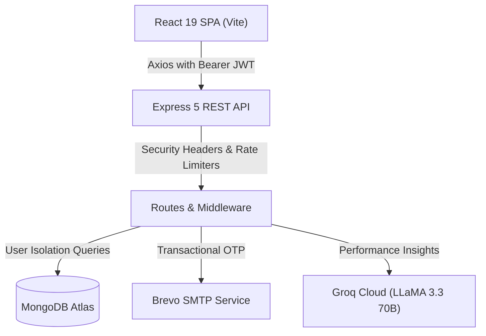

# Trade Empire 👑

> A professional full-stack trading journal, risk management, and analytics platform powered by React, Node.js, Express, MongoDB, and Groq LLaMA AI.

---

## 📖 Overview

**Trade Empire** is designed for modern stock, crypto, and derivative traders who want to maintain discipline, track performance mathematically, and eliminate emotional decision-making. 

Instead of messy spreadsheets, Trade Empire provides:
- A structured trade journal recording entries, exits, stop losses, and targets.
- Accurate net Profit & Loss (P&L) calculations for both **LONG** and **SHORT** trades.
- Automated **Risk-to-Reward (R:R)** ratio tracking.
- Psychological state tagging (pre-trade emotion, in-trade discipline, exit reasons, mistakes, and lessons learned).
- A monthly interactive trading calendar showing day-by-day performance.
- Recharts-powered visual analytics: Cumulative equity curve, symbol profit/loss breakdown, and win/loss distribution.
- An AI Performance Coach powered by Groq LLaMA 3.3 70B offering personalized, actionable feedback on trade execution.
- Transactional OTP email verification via Brevo SMTP.

---

## 🛠️ Technology Stack

| Layer | Technologies |
| :--- | :--- |
| **Frontend** | React 19, Vite 8, React Router v7, Recharts 3, Framer Motion, Axios |
| **Backend** | Node.js (v20+ / v24), Express 5, Mongoose 9 |
| **Database** | MongoDB Atlas |
| **Authentication** | JSON Web Tokens (JWT), bcryptjs password hashing, 6-digit OTP verification |
| **Email Service** | Nodemailer with Brevo (Sendinblue) SMTP relay |
| **AI Integration** | Groq Cloud SDK (`llama-3.3-70b-versatile`) |
| **Testing** | Node.js built-in test runner (`node:test`, `node:assert`) |
| **Security** | In-memory rate limiting, security headers, user data isolation, input sanitization |

---

## 🏛️ Architecture Overview



---

## ✨ Features

### 1. Trade Journaling & Management
- **Position Support**: Accurate P&L calculations for both **LONG** (`(Exit - Entry) * Qty`) and **SHORT** (`(Entry - Exit) * Qty`) positions.
- **Risk Framework**: Automatically computes live and stored Risk-to-Reward (R:R) ratios when entry, stop loss, and target prices are set.
- **Strategy & Psychology Tracking**: Tag setups (Breakout, Momentum, Reversal, S/R, Trend Following), market bias, emotional mindset, exit reasons, mistakes, and lessons learned.
- **Strict User Data Isolation**: Every trade query, update, and deletion is strictly scoped to the authenticated user's ID, preventing Insecure Direct Object References (IDOR).

### 2. Analytics & Visualizations
- **Summary Metrics**: Total P&L, Win Rate (%), Total Trades, Average Profit, Average Loss, and Win/Loss count.
- **Cumulative P&L Chart**: Responsive equity curve showing cumulative growth trade-by-trade.
- **Symbol P&L Chart**: Bar chart highlighting the most profitable and least profitable tickers.
- **Win/Loss Pie Chart**: Visual breakdown of winning vs. losing trades.

### 3. Trading Calendar & Simulator
- **Monthly Calendar**: Visualizes green days (profit), red days (loss), and neutral days, with daily trade counts and net P&L.
- **Simulator Tab**: Embedded TradingView technical charts with RSI & MACD alongside a pre-trade execution checklist.

### 4. AI Performance Coach
- Queries user trade history to generate strategic feedback.
- Highlights discipline weaknesses, stop loss compliance, and position sizing habits.
- Includes a graceful fallback when external AI services or keys are unavailable.

### 5. Authentication & Security
- Secure registration with bcrypt password hashing (10 salt rounds).
- 6-digit OTP email verification with 10-minute expiry and 5-attempt brute-force protection.
- Resend OTP endpoint with a 60-second cooldown timer.
- HTTP security headers (`nosniff`, `DENY` framing, `Strict-Transport-Security`, `X-XSS-Protection`).
- Rate limiting on authentication, contact, and AI endpoints.

---

## 🚀 Getting Started

### Prerequisites
- Node.js (v20.x or higher recommended)
- npm (v10+)
- A MongoDB database (MongoDB Atlas or local instance)

---

### 1. Installation

Clone the repository and install dependencies for both the backend and frontend:

```bash
# Clone the repository
git clone https://github.com/123rohitkumarr/Trade-Empire.git
cd Trade-Empire

# Install backend dependencies
cd backend
npm install

# Install frontend dependencies
cd ../frontend
npm install
```

---

### 2. Environment Configuration

Create a `.env` file in the `backend` directory based on `backend/.env.example`:

```bash
cd ../backend
cp .env.example .env
```

Populate `backend/.env` with your credentials:

```env
PORT=5000
NODE_ENV=development
FRONTEND_URL=http://localhost:5173
MONGO_URI=mongodb+srv://<username>:<password>@cluster.mongodb.net/tradeempire?retryWrites=true&w=majority
JWT_SECRET=your_jwt_secret_key_minimum_32_chars_random_string
GROQ_KEY=gsk_your_groq_api_key_here
EMAIL_HOST=smtp-relay.brevo.com
EMAIL_PORT=587
EMAIL_USER=your_brevo_login_email@example.com
EMAIL_PASS=your_brevo_smtp_key
EMAIL_FROM=no-reply@tradeempire.com
```

Create a `.env` file in the `frontend` directory based on `frontend/.env.example`:

```bash
cd ../frontend
cp .env.example .env
```

```env
VITE_API_URL=http://localhost:5000/api
```

---

### 3. Running Locally

Start the backend server:

```bash
cd backend
npm run dev
# Server runs on http://localhost:5000
```

In a separate terminal, start the frontend development server:

```bash
cd frontend
npm run dev
# Frontend runs on http://localhost:5173
```

---

## 🧪 Running Tests & Quality Checks

### Backend Unit & Integration Tests
Uses Node.js's built-in native test runner:

```bash
cd backend
npm test
```

Test coverage includes:
- Long & Short P&L calculations and decimal rounding
- Risk-to-Reward ratio calculations and edge case validation
- Security headers and in-memory rate limiting
- JWT authentication middleware verification
- In-memory API integration tests (`/health`, `/`, route error handling)
- Trade input validation and IDOR user isolation logic

### Frontend Linting & Production Build

```bash
cd frontend
# Check code style and hook rules
npm run lint

# Compile production bundle
npm run build
```

---

## 📡 API Reference

### Authentication (`/api/auth`)
| Method | Endpoint | Description | Auth Required |
| :--- | :--- | :--- | :--- |
| `POST` | `/api/auth/register` | Register new user and send verification OTP | No |
| `POST` | `/api/auth/verify-otp` | Verify email with 6-digit OTP code | No |
| `POST` | `/api/auth/resend-otp` | Resend verification OTP (60s cooldown) | No |
| `POST` | `/api/auth/login` | Log in and receive JWT token | No |

### Trades (`/api/trades`)
| Method | Endpoint | Description | Auth Required |
| :--- | :--- | :--- | :--- |
| `GET` | `/api/trades` | Fetch user's trade history (supports `symbol`, `type`, `limit`) | Yes (Bearer) |
| `GET` | `/api/trades/:id` | Fetch details of a single trade | Yes (Bearer) |
| `POST` | `/api/trades` | Create a new trade record | Yes (Bearer) |
| `PUT` | `/api/trades/:id` | Update trade attributes (recalculates P&L & R:R) | Yes (Bearer) |
| `DELETE` | `/api/trades/:id` | Delete trade record (user-isolated) | Yes (Bearer) |

### AI Coaching (`/api/ai`)
| Method | Endpoint | Description | Auth Required |
| :--- | :--- | :--- | :--- |
| `GET` | `/api/ai/insights` | Generate personalized trading advice using Groq LLaMA | Yes (Bearer) |

### Contact & Health
| Method | Endpoint | Description | Auth Required |
| :--- | :--- | :--- | :--- |
| `POST` | `/api/contact/send` | Send contact inquiry message | No (Rate Limited) |
| `GET` | `/health` | Server uptime and database connectivity status | No |

---

## 🔒 Security Practices

1. **User Isolation**: No database query for private data executes without filtering by `userId: req.user._id`.
2. **Brute Force Protection**: Registration and login endpoints have IP-based rate limiting; OTP verification is limited to 5 attempts.
3. **No Secrets in Source Control**: Credentials are strictly loaded via `.env` files; `.gitignore` rules prevent accidental secret exposure.
4. **Sanitized Inputs**: All user-submitted emails are trimmed and converted to lowercase; contact form messages are sanitized against XSS.

---

## 📄 License

ISC License. Built with ❤️ by Rohit Dhakad.

